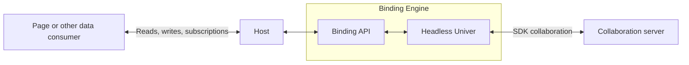
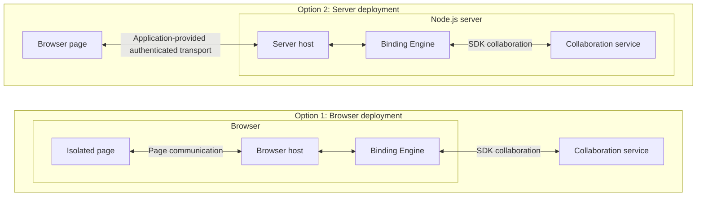
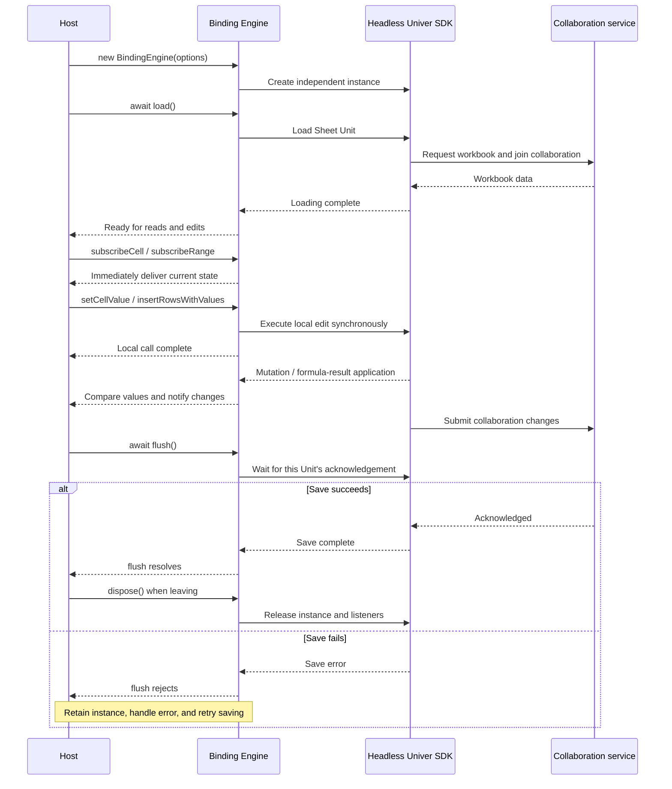

# Univer Binding Engine

[简体中文](README.zh-CN.md)

`@univerkit/binding-engine` loads a collaborative workbook without a spreadsheet UI. A browser or Node.js host can read cells and ranges, subscribe to changes, write scalar values, insert rows, and wait for server acknowledgement. Each engine owns one Sheet Unit and one independent Headless Univer instance.

For the overall design of HTML data binding and how the three packages divide the work, see the [HTML data binding overview](../html-view-renderer/docs/overview.zh-CN.md) (Simplified Chinese).

## Responsibilities and ownership

Each engine binds one Sheet Unit and owns an independent Headless Univer instance. The host creates the engine and decides when to load, save, and dispose; the engine manages its SDK instance and subscriptions.

| Layer                 | Responsibility                                                                                                  |
| --------------------- | --------------------------------------------------------------------------------------------------------------- |
| Host                  | Application identity, Unit source authorization, licensing, reference policy, page interaction, and navigation. |
| Binding Engine        | Fixed-coordinate reads/writes, change subscriptions, collaboration status, and instance lifecycle.              |
| Univer SDK            | Data model, formula calculation, permission mechanisms, and collaboration client.                               |
| Collaboration service | Server-side access checks, client synchronization, and persistence.                                             |

Engine accepts a Unit ID, SDK collaboration configuration, and an optional Univer factory. It does not read application login configuration or manage HTML, CSS, JavaScript, or page communication. An isolated page accesses the engine through a host-provided data client; it does not own internal Univer instances or host credentials.

## Core structure and deployment

### Core structure



The engine contains the Binding API and Headless Univer. The host calls the API, while the SDK synchronizes with the collaboration service. Values delivered to the page come from the SDK data model, including calculated formula results.

### Deployment options



In a browser deployment the local host calls Engine, and HTML View Renderer provides messaging between the iframe page and host. In a Node.js deployment Engine runs server-side; the application supplies authenticated browser-to-host transport and selects an SDK socket service suitable for Node. Each engine in either option owns an independent Headless Univer instance.

Groups represent deployment locations, not a requirement to run Engine and the collaboration service in the same process. In a server deployment the collaboration service can also run on another server. The example below demonstrates a browser host; the server deployment diagram does not imply that this package includes a remote access service.

## Usage flow

1. **Prepare host configuration**: authorize access to the target Unit, obtain stable workbook and worksheet IDs, and configure collaboration connections and required application services.
2. **Create and load**: constructing Engine creates its Headless Univer instance. Then `await engine.load()` loads the workbook; data operations require successful loading.
3. **Read and subscribe**: read current state and subscribe to cells, ranges, or collaboration status. Subscriptions deliver current state first, then subsequent changes.
4. **Edit and receive updates**: call `setCellValue()` or `insertRowsWithValues()` for local edits. The SDK handles collaboration and formulas; subscriptions deliver changes to consumers.
5. **Wait for save acknowledgement**: `await engine.flush()` waits for server collaboration acknowledgement. Local write completion and save confirmation are separate stages. If saving fails, retain the engine, handle the error, and retry `flush()`.
6. **Finish and dispose**: when leaving, stop new edits and save successfully, then cancel consumer subscriptions and call `engine.dispose()`. If saving and continuing to edit, a successful Engine `flush()` does not disable subsequent writes.

The sequence below covers loading, editing, saving, and leaving. An application can perform multiple edits between saves.



## Install and prerequisites

```sh
npm install --save-exact "@univerkit/binding-engine@rc" --registry=https://insider-npm-registry.univer.work/
npm install "@univerjs-pro/collaboration-client-ui@^1.6.0" --registry=https://insider-npm-registry.univer.work/
```

The three data binding packages are released together, with internal dependencies pinned to that exact release version. Above, `@rc` selects the current rc release and `--save-exact` records the resolved version in your application; for another channel, replace `@rc` with the same exact release version for each package. Univer/Pro dependencies still use `^1.6.0`.

Use Node.js 24+ for the tooling in these guides and a browser bundler such as Vite for the browser example. Modern npm installs the declared Univer peer dependencies; package managers that do not install peers automatically must install those listed in this package’s `package.json`. Univer and Pro peers accept `^1.6.0`; keep a compatible SDK set in your application lockfile. The range is not a promise of compatibility with every future release.

You need an existing workbook ID (`unitId`), a worksheet’s stable ID (`sheetId`, not its tab name), and a deployed Univer collaboration service. The host supplies the signed-in session, authorization, and any required Pro license. This package neither creates a backend nor implements login. The browser example assumes your authenticated application proxies `/universer-api` to that service, including WebSocket upgrades and session-ticket requests. Adapt the endpoint URLs and SDK authentication configuration to your deployment.

## Complete browser example

Save this as `binding.ts` in your browser application. Both exported functions take real, host-authorized IDs; there are no repository-only imports or hidden helper functions. `editCell()` changes A1 to 42. Keep the returned controller while the view is open; after a successful `save()`, call `dispose()` when leaving. A failed save should leave the controller alive for retry. Calling `dispose()` explicitly discards the opportunity to wait for unsaved changes.

```ts
import { BindingEngine } from "@univerkit/binding-engine";
import { BrowserCollaborationSocketService } from "@univerjs-pro/collaboration-client-ui";

export async function openCell(unitId: string, sheetId: string) {
  const base = `${location.origin}/universer-api`;
  const engine = new BindingEngine({
    unitId,
    collaborationClientConfig: {
      socketService: BrowserCollaborationSocketService,
      snapshotServerUrl: `${base}/snapshot`,
      collabSubmitChangesetUrl: `${base}/comb`,
      collabWebSocketUrl: `${location.protocol === "https:" ? "wss:" : "ws:"}//${location.host}/universer-api/comb/connect`,
      wsSessionTicketUrl: `${base}/user/session-ticket`,
      authzUrl: `${base}/authz`,
    },
  });
  try {
    await engine.load();
  } catch (error) {
    engine.dispose();
    throw error;
  }
  const reference = { sheetId, row: 0, col: 0 };
  const valueSubscription = engine.subscribeCell(reference, ({ value }) =>
    console.log("A1:", value),
  );
  const statusSubscription = engine.subscribeCollaborationStatus((status) =>
    console.log("Sync:", status),
  );
  return {
    read: () => engine.getCellState(reference),
    write: (value: string | number | boolean) => engine.setCellValue(reference, value),
    save: () => engine.flush(),
    dispose() {
      valueSubscription.dispose();
      statusSubscription.dispose();
      engine.dispose();
    },
  };
}

// Invoke after your application has selected an authorized workbook and sheet.
export async function editCell(unitId: string, sheetId: string) {
  const cell = await openCell(unitId, sheetId);
  console.log(cell.read());
  cell.write(42);
  // Return the controller even when saving fails, so the caller can retry.
  try {
    await cell.save();
  } catch (error) {
    console.error("Save failed; retry cell.save().", error);
  }
  return cell;
}
```

## Cell references and values

A reference is `{ sheetId, row, col }`; coordinates are non-negative safe integers starting at zero. For example B7 is `{ row: 6, col: 1 }`. Coordinates stay fixed when rows or columns move: subscriptions then read the new content at that position. IDs are case sensitive.

Reads return `{ value }`, preserving strings, numbers, and booleans. Empty cells, missing worksheets, and out-of-bounds reads return `null`; formulas return their calculated value. Writes require a string, finite number, or boolean, and throw for missing coordinates. `setCellValue()` does not accept `null`. Strings such as `"=SUM(A1:A2)"` remain literal text. Writing a scalar explicitly replaces the old formula and rich text. Engine does not separately query or subscribe to cell permissions; SDK/server permission enforcement still applies.

## Read and subscribe to ranges

The following function accepts an already loaded engine. Dispose its returned subscription when the consumer is removed.

```ts
import type { BindingEngine, RangeReference } from "@univerkit/binding-engine";

export function watchBudget(engine: BindingEngine, sheetId: string) {
  const reference: RangeReference = {
    sheetId,
    range: { startRow: 2, endRow: 3, startColumn: 1, endColumn: 1 },
  };
  console.log(engine.getRangeState(reference));
  return engine.subscribeRange(reference, ({ value }) => {
    console.table(value); // B3:B4: [[income], [expenses]]
  });
}
```

The four `range` boundaries are inclusive, zero-based non-negative safe integers; ends must not precede starts. Other `IRange` selection metadata does not affect reads. Results are readonly row-major matrices with exactly the requested dimensions; missing or out-of-bounds positions are padded with `null`. Subscriptions copy the reference, deliver a full matrix immediately, then deliver a new full matrix only when values change. Identical ranges share reads; overlapping ranges are independent. Listener exceptions do not block other listeners.

## Insert rows with values

```ts
import type { BindingEngine } from "@univerkit/binding-engine";

export async function addRecords(engine: BindingEngine, sheetId: string) {
  engine.insertRowsWithValues({
    sheetId,
    startRow: 1,
    rowCount: 3,
    startColumn: 0,
    values: [
      ["Alice", 123, true],
      ["Bob", null, false],
    ],
  });
  await engine.flush();
}
```

This inserts three complete rows at index 1, shifts existing rows down, fills the first two new rows from column A, and leaves the third blank. Run it only when you intend to insert data; retrying insertion after a save failure can insert duplicate rows. Retry `engine.flush()` to wait for the already applied edit.

`startRow` and `startColumn` must be non-negative safe integers; `rowCount` must be a positive safe integer. `startRow` may equal the current row count to append, but cannot exceed it. `values` is a non-empty rectangular matrix local to the new rows, with `values.length <= rowCount`. Values are strings, finite numbers, booleans, or `null` (blank). Width must fit the remaining columns; columns are not expanded automatically. Omitted rows and columns remain blank. All arguments are validated before the synchronous SDK `InsertRowByRangeCommand` inserts and fills rows. Local completion is separate from server acknowledgement.

Internally, the public Facade `syncExecuteCommand()` invokes `InsertRowByRangeCommand`, inserting and filling rows in the same synchronous command and following the SDK collaboration flow.

## API reference

The following summary shows the exported reference, state, factory, and insertion parameter types. Import these types from the package in application code.

```ts
import type { ICellData, IRange } from "@univerjs/core";
import type { createUniver } from "@univerjs/presets";
import type { IUniverCollaborationClientConfig } from "@univerjs-pro/collaboration-client";

export type BindingUniverFactory = (
  collaborationClientConfig: IUniverCollaborationClientConfig,
) => ReturnType<typeof createUniver>;

export interface BindingEngineOptions {
  readonly unitId: string;
  readonly collaborationClientConfig: IUniverCollaborationClientConfig;
  readonly createUniver?: BindingUniverFactory;
}
export type CellValue = NonNullable<ICellData["v"]>;
export interface CellReference {
  readonly sheetId: string;
  readonly row: number;
  readonly col: number;
}
export interface SheetInfo {
  readonly sheetId: string;
  readonly name: string;
}
export interface CellState {
  readonly value: CellValue | null;
}

export interface RangeReference {
  readonly sheetId: string;
  readonly range: Readonly<IRange>;
}
export interface RangeState {
  readonly value: readonly (readonly (CellValue | null)[])[];
}

export interface InsertRowsWithValuesParams {
  readonly sheetId: string;
  readonly startRow: number;
  readonly rowCount: number;
  readonly startColumn: number;
  readonly values: readonly (readonly (CellValue | null)[])[];
}
```

Engine methods are listed below. Reads and local writes are synchronous; loading and saving return promises.

```ts
import type { IDisposable } from "@univerjs/core";
import type { CollaborationStatus } from "@univerjs-pro/collaboration-client";
import type {
  BindingEngineOptions,
  CellReference,
  CellState,
  CellValue,
  RangeReference,
  RangeState,
  InsertRowsWithValuesParams,
  SheetInfo,
} from "@univerkit/binding-engine";

// Signature summary; import BindingEngine from the package to construct it.
declare class BindingEngine implements IDisposable {
  constructor(options: BindingEngineOptions);
  readonly unitId: string;
  load(): Promise<void>;
  getSheets(): readonly SheetInfo[];
  getCellState(reference: CellReference): CellState;
  subscribeCell(reference: CellReference, listener: (state: CellState) => void): IDisposable;
  getRangeState(reference: RangeReference): RangeState;
  subscribeRange(reference: RangeReference, listener: (state: RangeState) => void): IDisposable;
  setCellValue(reference: CellReference, value: CellValue): void;
  insertRowsWithValues(params: InsertRowsWithValuesParams): void;
  getCollaborationStatus(): CollaborationStatus;
  subscribeCollaborationStatus(listener: (status: CollaborationStatus) => void): IDisposable;
  flush(): Promise<void>;
  dispose(): void;
}
```

`BindingEngineOptions` requires `unitId` and `collaborationClientConfig: IUniverCollaborationClientConfig`, and optionally accepts `createUniver: BindingUniverFactory`. All reference/state/option types above are exported by this package. `CellValue` reuses SDK `NonNullable<ICellData["v"]>`; `RangeReference` contains `sheetId` and `Readonly<IRange>`. `RangeState.value` is a readonly matrix of `CellValue | null`. Reads and local writes are synchronous; loading and saving return promises.

`getSheets()` lists the loaded workbook's sheets in tab order as `{ sheetId, name }`, reading the current names on each call. Use it to show names for sheet IDs, for example in binding inspection.

## Univer factory

The exported `createDefaultBindingUniver(config)` installs headless sheets, formula calculation, networking, and collaboration. A custom `BindingUniverFactory` synchronously receives the collaboration config and returns `{ univer, univerAPI }` using the SDK `createUniver` return type. Configure application identity, licensing, and reference policy there as needed, retaining all required headless/collaboration services. Ownership transfers to Engine; do not share one Univer instance between engines.

## Change subscriptions

Subscriptions immediately deliver current state and subsequently notify only value changes. Every registration cancels independently, even when the caller registers the same callback more than once.

Engine shares state reads by cell coordinate or complete range: each target is read once per refresh and the result is distributed to its listeners. Target Unit mutations and formula-result application trigger refreshes; changes in the same turn are coalesced before rereading the subscribed coordinates or ranges and comparing values. Range and structural behavior follows the SDK data model rather than duplicating formula or collaboration logic in Engine.

Removing the last subscriber removes its coordinate record. Subscriber exceptions are reported through the shared notification entry without blocking other subscribers.

See [subscription behavior, listening code, and strategy comparison](docs/change-subscription.md) for the detailed entry points and tradeoffs.

## Lifecycle

`load()` reuses one promise. Data operations require successful loading; failure disposes the instance, so retry with a new Engine.

`getCollaborationStatus()` and its subscription expose SDK `CollaborationStatus`; the subscription immediately reports current status. `flush()` waits for this Unit’s collaboration acknowledgement and rejects on failure. `dispose()` is idempotent, removes all listeners and releases Univer; it never saves implicitly. New operations after disposal fail; results that arrive after disposal during loading are released rather than delivered. Keep the engine alive if saving fails and the user needs to retry.

Retry acknowledgement after a save failure rather than automatically repeating an already applied write or insertion. Engine `flush()` waits for collaboration acknowledgement; pausing page interaction and stopping new edits remain host responsibilities. Canceling one subscription does not dispose Engine; disposing Engine cancels all of its subscriptions.

## Browser integration boundary

In a browser deployment the host calls Engine and connects to the collaboration server. In a Node.js deployment Engine runs server-side with an SDK socket service suitable for Node; your application must supply the authenticated transport between browser and server. The browser socket class above is not a Node transport. Neither deployment exposes an Engine or credentials to untrusted HTML. Univer UI Facade extensions are global to a JavaScript environment: place a Sheet UI editor and a Headless Engine in separate environments, such as separate pages or frames.

Do not add unrelated UI services to Headless Engine to satisfy UI Facade listeners. For example, save the current edits before navigating to a separate spreadsheet editor page.

## Troubleshooting

If loading fails, verify the stable Unit ID, logged-in session, HTTP endpoints and WebSocket/session-ticket requests in browser developer tools. A `null` read can mean a wrong Sheet ID or coordinate as well as an empty cell. A literal string that looks like a formula is expected; this API writes scalars. A local write followed by a failed `flush()` is not a successful save. For iframe rendering install `@univerkit/html-view-renderer` and read its bundled README and `docs/integration.md`.

## Local validation

These commands are for maintainers with a repository checkout. npm consumers can use the integration examples above directly.

```bash
pnpm --filter @univerkit/binding-engine typecheck
pnpm --filter @univerkit/binding-engine test
```

## Distribution

ES modules, CommonJS, and TypeScript declarations are included; source files and source maps are not. Both READMEs and all `docs/*.md` files ship in the npm package. Read them under `node_modules/@univerkit/`.

## License

Licensed under Apache-2.0. This package depends on Univer Pro (`@univerjs-pro/*`); using it follows the [Univer license terms](https://docs.univer.ai/server/license). Third-party dependencies retain their own licenses.
