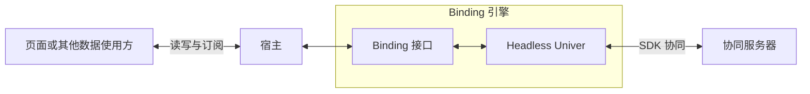
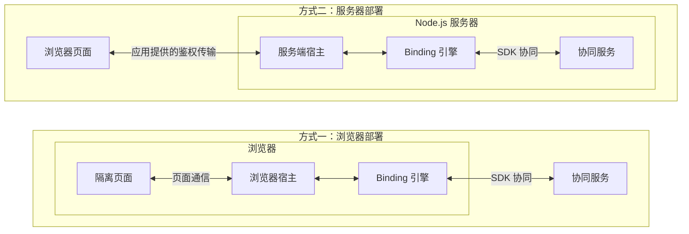
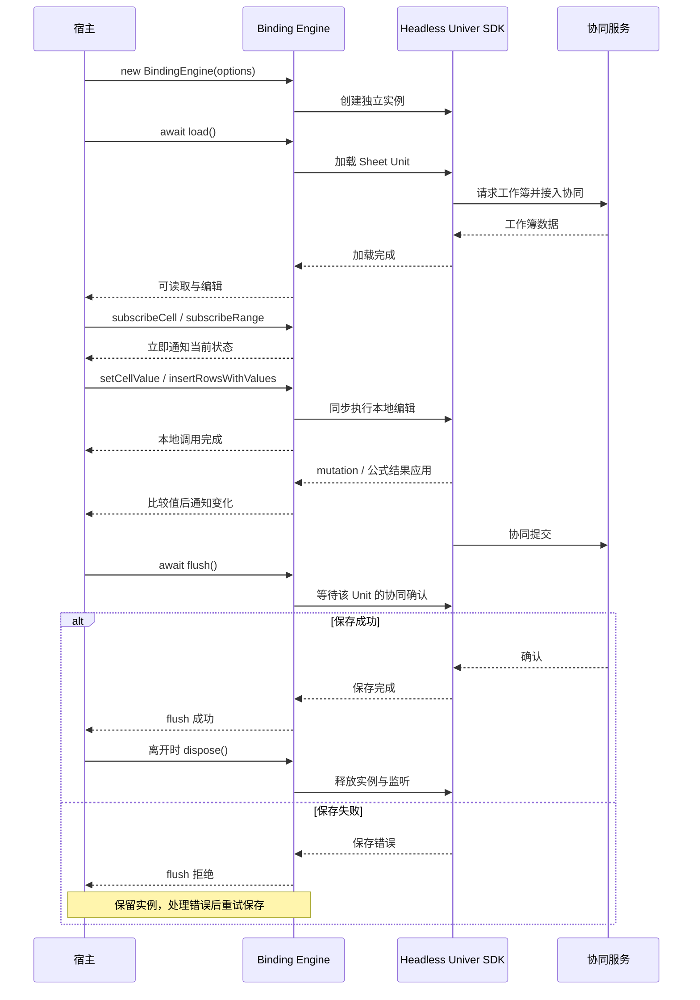

# Univer Binding Engine

[English](README.md)

`@univerkit/binding-engine` 无需表格 UI 即可加载协同工作簿。浏览器或 Node.js 宿主可以读取单元格和范围、订阅变化、写入标量、插行并等待服务端确认。每个 Engine 绑定一个 Sheet Unit，并拥有一个独立的 Headless Univer 实例。

HTML 数据绑定的整体设计和三个包的分工见[HTML 数据绑定概览](../html-view-renderer/docs/overview.zh-CN.md)。

## 职责与所有权

每个 Engine 绑定一个 Sheet Unit，并拥有一个独立的 Headless Univer 实例。宿主创建 Engine，并决定何时加载、保存和释放；Engine 统一管理其持有的 SDK 实例与订阅。

| 层次           | 职责                                                                |
| -------------- | ------------------------------------------------------------------- |
| 宿主           | 产品身份、Unit 来源授权、许可证、引用策略，以及页面交互与离开流程。 |
| Binding Engine | 组织固定坐标读写、变化订阅、协同状态和实例生命周期。                |
| Univer SDK     | 数据模型、公式计算、权限机制与协同客户端。                          |
| 协同服务       | 服务端访问校验、客户端同步与持久化。                                |

Engine 接收 Unit ID、SDK 协同配置和可选的 Univer 工厂，不读取应用登录配置，也不管理 HTML、CSS、JavaScript 或页面通信。隔离页面通过宿主提供的数据客户端访问 Engine；页面不持有内部 Univer 实例或宿主凭据。

## 核心结构与部署方式

### 核心结构



图中的 Engine 包含 Binding 接口与 Headless Univer。宿主调用接口，SDK 与协同服务同步；页面所见的值来自 SDK 数据模型，包括公式计算结果。

### 部署方式



浏览器部署由本地宿主调用 Engine，HTML View Renderer 提供 iframe 页面与宿主之间的消息通信。Node.js 部署将 Engine 放在服务端，应用自行提供浏览器到宿主的鉴权传输，并选择适合 Node 的 SDK socket service。两种方案中的每个 Engine 都拥有独立的 Headless Univer 实例。

分组表示部署位置，不要求 Engine 与协同服务处于同一进程；服务端部署时，协同服务也可以位于另一台服务器。下方示例演示浏览器宿主，上面的服务器部署图不代表本包内置了远程访问服务。

## 使用流程

1. **准备宿主配置**：确认用户可以访问目标 Unit，取得稳定工作簿与子表 ID，准备协同连接和所需应用服务。
2. **创建并加载**：构造 Engine 时创建其 Headless Univer 实例，随后 `await engine.load()` 加载工作簿；成功前不能进行数据操作。
3. **读取并订阅**：读取当前状态，建立单元格、范围或协同状态订阅。订阅先通知当前状态，再通知后续变化。
4. **编辑并接收更新**：调用 `setCellValue()` 或 `insertRowsWithValues()` 执行本地编辑。SDK 负责协同与公式计算，变化通过订阅返回使用方。
5. **等待保存确认**：`await engine.flush()` 等待服务端协同确认。本地写入返回与保存确认是两个阶段；保存失败时保留 Engine，处理错误并重试 `flush()`。
6. **结束并释放**：需要离开时，先停止新的编辑并成功保存，再取消使用方订阅并调用 `engine.dispose()`。如仅保存后继续编辑，成功的 Engine `flush()` 不会禁用后续写入。

下面的时序图展示从加载、编辑到保存离开的完整路径。实际应用可以在两次保存之间进行多次编辑。



## 安装与前置条件

```sh
npm install --save-exact "@univerkit/binding-engine@rc" --registry=https://insider-npm-registry.univer.work/
npm install "@univerjs-pro/collaboration-client-ui@^1.6.0" --registry=https://insider-npm-registry.univer.work/
```

三个数据绑定包按同一版本一起发布，包间依赖锁定该次发布的精确版本。上面的 `@rc` 选择当前 rc 发布，`--save-exact` 将解析出的精确版本写入应用依赖；需要其他通道时，把 `@rc` 换成同一次发布的精确版本号。Univer/Pro 依赖仍使用 `^1.6.0`。

本文工具链使用 Node.js 24+，浏览器示例需使用 Vite 等打包工具。现代 npm 会安装声明的 Univer peer dependencies；若包管理器不自动安装 peer，请安装本包 `package.json` 中列出的依赖。Univer 和 Pro 的 peer 范围为 `^1.6.0`，应用锁文件应保持一组兼容的 SDK。该范围不代表对所有未来版本的兼容承诺。

需要已有工作簿 ID（`unitId`）、子表的稳定 ID（`sheetId`，不是标签名称），以及部署好的 Univer 协同服务。宿主提供登录会话、授权和所需 Pro 许可证。本包不创建后端或实现登录。浏览器示例假定已登录的应用将 `/universer-api` 代理到该服务，包括 WebSocket 升级和 session-ticket 请求；请按部署调整 URL 与 SDK 鉴权配置。

## 完整浏览器示例

将以下代码保存为浏览器应用的 `binding.ts`。两个导出函数都接收真实、经宿主授权的 ID，没有仓库专用导入或隐藏辅助函数。`editCell()` 将 A1 改为 42。页面打开期间保留返回的控制器，离开时先成功执行 `save()`，再调用 `dispose()`。保存失败应保留控制器以便重试；主动调用 `dispose()` 将放弃继续等待未保存变更的机会。

```ts
import { BindingEngine } from "@univerkit/binding-engine";
import { BrowserCollaborationSocketService } from "@univerjs-pro/collaboration-client-ui";

export async function openCell(unitId: string, sheetId: string) {
  const base = `${location.origin}/universer-api`;
  const engine = new BindingEngine({
    unitId,
    collaborationClientConfig: {
      socketService: BrowserCollaborationSocketService,
      snapshotServerUrl: `${base}/snapshot`,
      collabSubmitChangesetUrl: `${base}/comb`,
      collabWebSocketUrl: `${location.protocol === "https:" ? "wss:" : "ws:"}//${location.host}/universer-api/comb/connect`,
      wsSessionTicketUrl: `${base}/user/session-ticket`,
      authzUrl: `${base}/authz`,
    },
  });
  try {
    await engine.load();
  } catch (error) {
    engine.dispose();
    throw error;
  }
  const reference = { sheetId, row: 0, col: 0 };
  const valueSubscription = engine.subscribeCell(reference, ({ value }) =>
    console.log("A1:", value),
  );
  const statusSubscription = engine.subscribeCollaborationStatus((status) =>
    console.log("Sync:", status),
  );
  return {
    read: () => engine.getCellState(reference),
    write: (value: string | number | boolean) => engine.setCellValue(reference, value),
    save: () => engine.flush(),
    dispose() {
      valueSubscription.dispose();
      statusSubscription.dispose();
      engine.dispose();
    },
  };
}

// Invoke after your application has selected an authorized workbook and sheet.
export async function editCell(unitId: string, sheetId: string) {
  const cell = await openCell(unitId, sheetId);
  console.log(cell.read());
  cell.write(42);
  // Return the controller even when saving fails, so the caller can retry.
  try {
    await cell.save();
  } catch (error) {
    console.error("Save failed; retry cell.save().", error);
  }
  return cell;
}
```

## 单元格引用与值

引用为 `{ sheetId, row, col }`，坐标从 0 开始，必须为非负安全整数。例如 B7 对应 `{ row: 6, col: 1 }`。行列移动后坐标保持固定，订阅读取该位置的新内容。ID 区分大小写。

读取返回 `{ value }`，保留字符串、数值、布尔值类型。空单元格、缺失子表和越界读取返回 `null`；公式返回计算结果。写入只接受字符串、有限数值或布尔值，坐标不存在时抛错。`setCellValue()` 不接受 `null`。`"=SUM(A1:A2)"` 等字符串仍按字面文本保存，标量写入明确替换旧公式和富文本。Engine 不额外查询或订阅单元格权限，仍由 SDK 和服务端执行权限校验。

## 范围读取与订阅

以下函数接收已加载的 Engine；使用方移除时释放返回的订阅。

```ts
import type { BindingEngine, RangeReference } from "@univerkit/binding-engine";

export function watchBudget(engine: BindingEngine, sheetId: string) {
  const reference: RangeReference = {
    sheetId,
    range: { startRow: 2, endRow: 3, startColumn: 1, endColumn: 1 },
  };
  console.log(engine.getRangeState(reference));
  return engine.subscribeRange(reference, ({ value }) => {
    console.table(value); // B3:B4: [[income], [expenses]]
  });
}
```

四个 `range` 边界从 0 开始、首尾均包含，必须为非负安全整数，结束不得早于起始。`IRange` 的其他选区元数据不影响读取。结果为按行排列的只读矩阵，尺寸始终与请求一致，缺失或越界部分填 `null`。订阅复制引用，立即通知完整矩阵，此后只在值变化时通知新的完整矩阵。相同范围共享读取，重叠范围各自管理，回调异常不阻断其他监听者。

## 插入行并填值

```ts
import type { BindingEngine } from "@univerkit/binding-engine";

export async function addRecords(engine: BindingEngine, sheetId: string) {
  engine.insertRowsWithValues({
    sheetId,
    startRow: 1,
    rowCount: 3,
    startColumn: 0,
    values: [
      ["Alice", 123, true],
      ["Bob", null, false],
    ],
  });
  await engine.flush();
}
```

示例在索引 1 插入三个完整行，将原有行向下移动，从 A 列填入前两条新行，第三行留空。仅在确实需要新增数据时执行；保存失败后重新调用插行可能产生重复行，应重试 `engine.flush()` 以等待已执行变更的确认。

`startRow` 和 `startColumn` 必须为非负安全整数，`rowCount` 为正安全整数。`startRow` 等于当前总行数时追加，不能超过总行数。`values` 为新行内的非空矩形局部矩阵，满足 `values.length <= rowCount`。值只接受字符串、有限数字、布尔值或表示空白的 `null`。宽度不能超过剩余列数，不自动扩列，未提供的行列留空。所有参数先完成校验，再由同步 SDK `InsertRowByRangeCommand` 插行并填值。本地完成与服务端确认分开。

内部通过公开 Facade 的 `syncExecuteCommand()` 调用 `InsertRowByRangeCommand`，将插行与填值放在同一次同步 command 中，并沿用 SDK 协同流程。

## 接口参考

以下为本包导出类型的结构摘要，可直接查看引用、状态、工厂和插行参数的字段。实际使用时从包中导入这些类型。

```ts
import type { ICellData, IRange } from "@univerjs/core";
import type { createUniver } from "@univerjs/presets";
import type { IUniverCollaborationClientConfig } from "@univerjs-pro/collaboration-client";

export type BindingUniverFactory = (
  collaborationClientConfig: IUniverCollaborationClientConfig,
) => ReturnType<typeof createUniver>;

export interface BindingEngineOptions {
  readonly unitId: string;
  readonly collaborationClientConfig: IUniverCollaborationClientConfig;
  readonly createUniver?: BindingUniverFactory;
}
export type CellValue = NonNullable<ICellData["v"]>;
export interface CellReference {
  readonly sheetId: string;
  readonly row: number;
  readonly col: number;
}
export interface CellState {
  readonly value: CellValue | null;
}

export interface RangeReference {
  readonly sheetId: string;
  readonly range: Readonly<IRange>;
}
export interface RangeState {
  readonly value: readonly (readonly (CellValue | null)[])[];
}

export interface InsertRowsWithValuesParams {
  readonly sheetId: string;
  readonly startRow: number;
  readonly rowCount: number;
  readonly startColumn: number;
  readonly values: readonly (readonly (CellValue | null)[])[];
}
```

Engine 方法如下，读取与本地写入同步执行，加载与保存返回 Promise。

```ts
import type { IDisposable } from "@univerjs/core";
import type { CollaborationStatus } from "@univerjs-pro/collaboration-client";
import type {
  BindingEngineOptions,
  CellReference,
  CellState,
  CellValue,
  RangeReference,
  RangeState,
  InsertRowsWithValuesParams,
} from "@univerkit/binding-engine";

// Signature summary; import BindingEngine from the package to construct it.
declare class BindingEngine implements IDisposable {
  constructor(options: BindingEngineOptions);
  readonly unitId: string;
  load(): Promise<void>;
  getCellState(reference: CellReference): CellState;
  subscribeCell(reference: CellReference, listener: (state: CellState) => void): IDisposable;
  getRangeState(reference: RangeReference): RangeState;
  subscribeRange(reference: RangeReference, listener: (state: RangeState) => void): IDisposable;
  setCellValue(reference: CellReference, value: CellValue): void;
  insertRowsWithValues(params: InsertRowsWithValuesParams): void;
  getCollaborationStatus(): CollaborationStatus;
  subscribeCollaborationStatus(listener: (status: CollaborationStatus) => void): IDisposable;
  flush(): Promise<void>;
  dispose(): void;
}
```

`BindingEngineOptions` 必须提供 `unitId` 和 `collaborationClientConfig: IUniverCollaborationClientConfig`，可选传入 `createUniver: BindingUniverFactory`。上述引用、状态和选项类型均由本包导出。`CellValue` 复用 SDK 的 `NonNullable<ICellData["v"]>`；`RangeReference` 包含 `sheetId` 和 `Readonly<IRange>`，`RangeState.value` 是 `CellValue | null` 的只读矩阵。读取与本地写入同步执行，加载与保存返回 Promise。

## Univer 工厂

导出的 `createDefaultBindingUniver(config)` 装配 Headless Sheet、公式计算、网络和协同能力。自定义 `BindingUniverFactory` 同步接收协同配置，返回 `{ univer, univerAPI }`，类型复用 SDK `createUniver` 的返回值。可按需在其中配置应用身份、许可证和引用策略，同时保留所需 Headless 与协同服务。实例所有权交给 Engine，不要在多个 Engine 之间共用同一个 Univer 实例。

## 变化订阅

订阅立即通知当前状态，随后只通知值的变化。每次注册独立取消，
即使调用方重复使用同一个回调函数。

Engine 按单元格坐标或完整范围共享状态读取，同一订阅目标每轮只读取一次再分发。通过目标 Unit 的 mutation、
公式结果应用触发刷新，将同一轮变化合并后重新读取订阅坐标或范围，比较值再通知。
范围和结构处理沿用 SDK 数据模型，不在 Engine 中复制公式或协同逻辑。

取消最后一个订阅后移除对应坐标记录。订阅者异常在统一通知入口报告，不阻断其他订阅者。

关键代码、监听入口与取舍见[订阅行为、关键代码与方案比较](docs/change-subscription.zh-CN.md)。

## 生命周期

`load()` 复用同一个 Promise。数据操作必须等待加载成功；加载失败会释放实例，重试需创建新 Engine。

`getCollaborationStatus()` 及其订阅直接提供 SDK `CollaborationStatus`，订阅立即报告当前状态。`flush()` 等待该 Unit 的协同确认，失败时拒绝 Promise。`dispose()` 幂等，移除所有监听并释放 Univer，不隐式保存。释放后新操作失败；加载过程中释放后迟到的结果会被释放，不再交付。如果保存失败且用户需要重试，应保留 Engine。

保存失败时只重试等待确认，不要自动重复执行已完成的写入或插行。Engine 的 `flush()` 用于等待协同确认；暂停页面交互与停止新的编辑由宿主负责。取消单个订阅不会释放 Engine，直接释放 Engine 则会取消其全部订阅。

## 浏览器集成边界

浏览器部署由宿主调用 Engine 并连接协同服务。Node.js 部署将 Engine 放在服务端并使用适合 Node 的 SDK socket service，应用需自行提供浏览器到服务端的鉴权传输。上面的浏览器 socket 类不是 Node 传输。两种部署均不向不可信 HTML 暴露 Engine 或凭据。Univer UI Facade 扩展作用于整个 JavaScript 环境，因此 Sheet UI 编辑器与 Headless Engine 应放在独立环境，例如不同页面或 frame。

不要向 Headless Engine 添加无关 UI 服务来满足 UI Facade 的监听。例如可先保存当前编辑，再导航到独立的表格编辑器页面。

## 排错

加载失败时，在浏览器开发者工具检查稳定 Unit ID、登录会话、HTTP 接口以及 WebSocket/session-ticket 请求。读取 `null` 除了空单元格，也可能意味着 Sheet ID 或坐标错误。公式形状的字符串按字面保存是预期行为，此接口写入标量。本地写入后 `flush()` 失败不代表保存成功。需要 iframe 渲染时安装 `@univerkit/html-view-renderer`，阅读其包内 README 和 `docs/integration.zh-CN.md`。

## 本地验证

以下命令供持有仓库源码的维护者使用；npm 使用方可直接使用上面的集成示例。

```bash
pnpm --filter @univerkit/binding-engine typecheck
pnpm --filter @univerkit/binding-engine test
```

## 发布内容

包含 ES modules、CommonJS 和 TypeScript 声明，不包含源码和 source map。两种语言的 README 和全部 `docs/*.md` 随 npm 包提供，可在 `node_modules/@univerkit/` 下阅读。

## 许可证

以 Apache-2.0 许可发布。本包依赖 Univer Pro（`@univerjs-pro/*`），使用时遵循 [Univer 许可规则](https://docs.univer.ai/zh-CN/server/license)。第三方依赖遵循各自的许可证。
