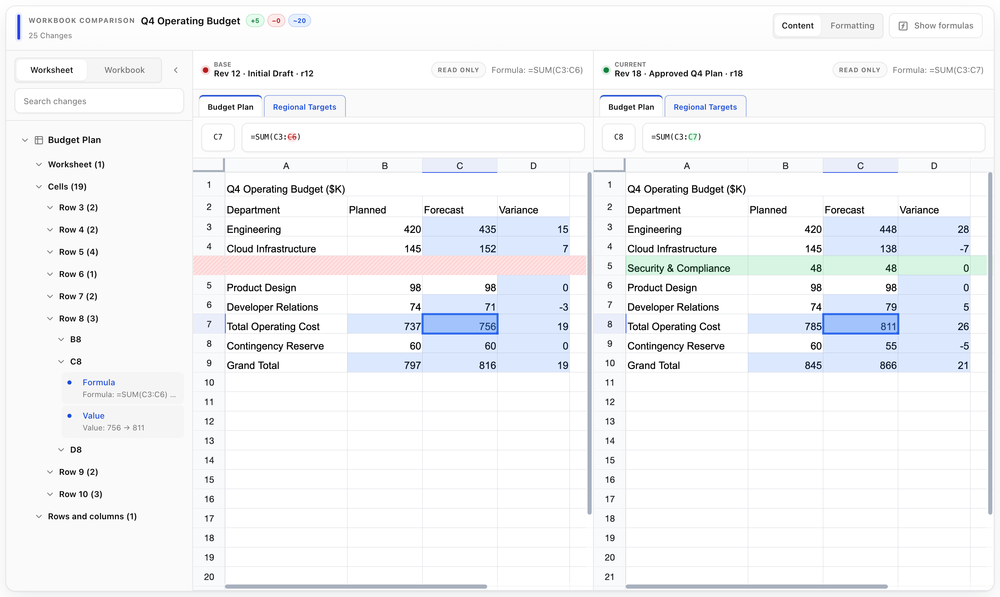

# Diff Viewer

English | [简体中文](./README.zh-CN.md)

`@univerkit/diff-viewer` is a React component for rendering a read-only, side-by-side comparison of Univer Sheet, Doc, Slide, Base, and Board Units with structural differences highlighted.

The package consumes a comparison result and decoded left/right `unitData` snapshots. It does not fetch comparison sessions, decode wire payloads, manage routing, or construct a configured Univer runtime; your host application provides those concerns through a narrow factory function.



## Responsibilities and boundaries

| Layer                    | Responsibility                                                                                                                                                                           |
| ------------------------ | ---------------------------------------------------------------------------------------------------------------------------------------------------------------------------------------- |
| Host application         | Fetching comparison payloads, decoding snapshots, configuring Univer presets/plugins, managing auth/licensing, and rendering optional left-header controls.                              |
| `@univerkit/diff-viewer` | Side-by-side layout, collapsible diff sidebar, sheet/slide/base scope switching, synchronized scrolling and selection, native highlights, formula diff strip, and built-in localization. |
| Univer SDK / Pro SDK     | Read-only Unit rendering, Facade APIs, and History locale dictionaries supplied as peer dependencies.                                                                                    |

## Getting started

Import the stylesheet after Tailwind CSS v4 so Tailwind scans the package output and generates the utility classes used by the viewer:

```css
@import "tailwindcss";
@import "@univerkit/diff-viewer/styles.css";
```

Render `UnitComparisonViewer` with the comparison payload and a host-owned `createUniver` factory:

```tsx
import { LocaleType } from "@univerjs/core";
import {
  UnitComparisonViewer,
  type UnitComparisonUniverFactory,
  type UnitComparisonViewerValue,
} from "@univerkit/diff-viewer";

const createComparisonUniver: UnitComparisonUniverFactory = async ({
  container,
  unitType,
  locale,
  darkMode,
}) => {
  // Replace createReadonlyUniver with your application's Univer setup
  // that registers the rendering plugins for `unitType` in read-only mode.
  const univer = createReadonlyUniver({ container, unitType, locale, darkMode });
  return {
    univer,
    dispose: () => univer.dispose(),
  };
};

export function ReviewComparison({
  comparison,
  darkMode,
}: {
  comparison: UnitComparisonViewerValue;
  darkMode: boolean;
}) {
  return (
    <div className="flex h-screen min-h-0 flex-col">
      <UnitComparisonViewer
        key={`${comparison.result.comparisonId}:${comparison.result.unit.unitId}`}
        comparison={comparison}
        createUniver={createComparisonUniver}
        locale={LocaleType.EN_US}
        darkMode={darkMode}
      />
    </div>
  );
}
```

When mounted inside a height-constrained flex or grid container, the viewer renders a collapsible change list on the left and synchronized read-only before/after panes on the right.

## Installation

Install the package from the Univer insider registry along with its peer dependencies:

```sh
pnpm add @univerkit/diff-viewer@rc --registry=https://insider-npm-registry.univer.work/
```

### Peer dependencies and supported environments

- **Runtime**: Browser environment with React `>=18 <20`, React DOM `>=18 <20`, and Tailwind CSS `>=4`.
- **Univer SDK (`^1.6.0`)**:
  - Core and rendering: `@univerjs/core`, `@univerjs/ui`, `@univerjs/drawing`, `@univerjs/engine-formula`, `@univerjs/engine-render`, `@univerjs/docs-ui`
  - Sheets: `@univerjs/sheets`, `@univerjs/sheets-ui`, `@univerjs/sheets-conditional-formatting`, `@univerjs/sheets-filter`, `@univerjs/sheets-formula`, `@univerjs/sheets-numfmt`, `@univerjs/sheets-table`
  - Univer Pro: `@univerjs-pro/bases`, `@univerjs-pro/boards`, `@univerjs-pro/boards-ui`, `@univerjs-pro/edit-history-ui`, `@univerjs-pro/slides`, `@univerjs-pro/slides-ui`

Keep all `@univerjs/*` and `@univerjs-pro/*` packages aligned on a single compatible version in your lockfile so the Univer DI graph and type identities remain consistent.

## Usage

### Lifecycle key

Pass a React `key` derived from the comparison session and Unit ID (for example `${comparison.result.comparisonId}:${comparison.result.unit.unitId}`). Change `key` only when the comparison session or target Unit changes. Worksheet switches, Slide page switches, and diff-item selections update incrementally inside the mounted viewer without remounting the outer component.

### Implementing `createUniver`

The host `createUniver` factory is the integration seam for applications with different presets or plugins:

- Register the rendering plugins required for the requested `options.unitType` (`UNIVER_SHEET`, `UNIVER_DOC`, `UNIVER_SLIDE`, `UNIVER_BASE`, or `UNIVER_BOARD`).
- Mount the instance into `options.container` using `options.locale` and `options.darkMode`, and configure the runtime to be read-only.
- The viewer calls `createUniver` once per present side (skipping a side whose `unitData` is `null`) and owns calling `dispose()` on unmount, theme/locale rebuilds, or Slide page changes.

### Styling and dark mode

`@univerkit/diff-viewer/styles.css` defines `@source "./dist";`, default Tailwind v4 `@theme` design tokens, dark-mode variable overrides on `[data-unit-comparison-viewer="true"][data-dark-mode="true"]`, and native host chrome overrides.

- Import `@univerkit/diff-viewer/styles.css` after Tailwind CSS (`@import "tailwindcss";` or `@import "tailwindcss/utilities.css";`).
- You can override the semantic color tokens (`--color-background`, `--color-card`, `--color-border`, `--color-diff-insert`, `--color-diff-delete`, `--color-diff-update`, and related tokens) in your application stylesheet.
- Toggle `darkMode` via props; the viewer sets `data-dark-mode` on its root element and passes `darkMode` to `createUniver`.
- Give the viewer's parent container a bounded height (such as `h-full` or `flex-1 min-h-0`) so internal panes and sidebars scroll independently.

### Localization and message overrides

The package ships built-in message packs for 17 Univer locales (`ca-ES`, `de-DE`, `en-US`, `es-ES`, `fr-FR`, `id-ID`, `it-IT`, `ja-JP`, `ko-KR`, `pl-PL`, `pt-BR`, `ru-RU`, `sk-SK`, `vi-VN`, `zh-CN`, `zh-HK`, `zh-TW`), falling back to `en-US` for unsupported `LocaleType` values.

Entity names, property paths, and schema enum values come from the matching `@univerjs-pro/edit-history-ui` locale pack; user document content is never translated. Pass the optional `messages` prop only when you want to override specific UI strings:

```tsx
<UnitComparisonViewer
  comparison={comparison}
  createUniver={createComparisonUniver}
  locale={LocaleType.EN_US}
  darkMode={false}
  messages={{
    changes: "Edits",
    side: { left: "Base", right: "Proposal" },
  }}
/>
```

### Custom left-header control

Pass `leftHeaderControl` to replace the default left-pane title block with host UI, such as a revision or comparison-source selector.

## API reference

### `UnitComparisonViewer`

```ts
export function UnitComparisonViewer(props: IUnitComparisonViewerProps): ReactElement;
```

Renders the appropriate comparison experience based on `props.comparison.result.unit.type`:

- **Sheet (`UNIVER_SHEET`)**: Synchronized side-by-side read-only workbooks with row/column gap alignment, worksheet/workbook sidebar tree, search, value vs. formatting display modes, formula text toggle, and formula diff strip.
- **Doc, Slide, Board (`UNIVER_DOC`, `UNIVER_SLIDE`, `UNIVER_BOARD`)**: Native read-only Univer panes with paragraph/element decorations, highlight overlays, slide page tabs, and viewport synchronization.
- **Base (`UNIVER_BASE`)**: Raw table diff grid with synchronized horizontal/vertical scrolling, table tabs, and field/record/cell change highlights.

### `IUnitComparisonViewerProps`

| Prop                | Type                                   | Required | Description                                                                                                                                                                     |
| ------------------- | -------------------------------------- | -------- | ------------------------------------------------------------------------------------------------------------------------------------------------------------------------------- |
| `comparison`        | `UnitComparisonViewerValue`            | Yes      | Discriminated union of comparison `result` plus decoded `left` and `right` sides (`SheetComparisonViewerValue`, `BaseComparisonViewerValue`, or `NativeComparisonViewerValue`). |
| `createUniver`      | `UnitComparisonUniverFactory`          | Yes      | Async factory creating one read-only Univer runtime per visible side.                                                                                                           |
| `locale`            | `LocaleType`                           | Yes      | Active Univer locale used for built-in viewer strings and passed to `createUniver`.                                                                                             |
| `darkMode`          | `boolean`                              | Yes      | Switches viewer dark-mode tokens and is passed to `createUniver`.                                                                                                               |
| `leftHeaderControl` | `ReactNode`                            | No       | Optional host control rendered in the left pane header instead of the default side label.                                                                                       |
| `messages`          | `UnitComparisonViewerMessageOverrides` | No       | Deep-partial wording overrides merged over the built-in locale resolved from `locale`.                                                                                          |

### `UnitComparisonUniverFactory`

```ts
export interface IUnitComparisonUniverFactoryOptions {
  readonly container: HTMLElement;
  readonly unitType: UnitComparisonType;
  readonly locale: LocaleType;
  readonly darkMode: boolean;
}

export interface IUnitComparisonUniverInstance {
  readonly univer: Univer;
  dispose(): void;
}

export type UnitComparisonUniverFactory = (
  options: IUnitComparisonUniverFactoryOptions,
) => Promise<IUnitComparisonUniverInstance>;
```

### Message helpers

- `defaultUnitComparisonViewerMessages`: Built-in English (`en-US`) `IUnitComparisonViewerMessages` object.
- `resolveUnitComparisonViewerMessages(locale?: LocaleType, overrides?: UnitComparisonViewerMessageOverrides): IUnitComparisonViewerMessages`: Resolves the built-in message dictionary for `locale` (defaulting to `en-US`) and deep-merges optional `overrides`.

### Exported types

- `IUnitComparisonResult`: Structured comparison result payload (`schemaVersion: 1`, `comparisonId`, `unit`, `fidelity`, `summary`, `coverage`, `scopes`, `page`, `items`, `diagnostics`, `productContext`).
- `IUnitComparisonViewerProps`: Component props for `UnitComparisonViewer`.
- `IUnitComparisonViewerSide<TData>`: One side of a comparison (`label`, optional `revision`, and decoded `unitData: TData | null`).
- `UnitComparisonViewerValue`: Union of Sheet, Base, and Native (Doc, Slide, Board) comparison viewer payloads.
- `UnitComparisonUniverFactory`, `IUnitComparisonUniverFactoryOptions`, `IUnitComparisonUniverInstance`: Univer runtime factory contract.
- `IUnitComparisonViewerMessages`, `UnitComparisonViewerMessageOverrides`: Full and deep-partial message override types.

## Limits and troubleshooting

- **Both sides missing (`unitData: null`)**: For Sheet comparisons, if both `left.unitData` and `right.unitData` are `null`, the viewer renders an inline invalid-payload notice without invoking `createUniver`. For a single missing side, the missing pane displays a "Not present" placeholder and does not allocate a Univer instance.
- **Unstyled layout or missing utility classes**: Ensure `@import "@univerkit/diff-viewer/styles.css";` is loaded by a Tailwind CSS v4 pipeline so `@source "./dist";` is processed.
- **Collapsed height / broken scrolling**: The root viewer uses `h-full min-h-0 flex-1`; make sure ancestor containers establish a definite height (`h-screen`, `h-[600px]`, or a flex/grid chain with `min-h-0`).
- **Multiple Univer instances or DI errors**: Verify your lockfile resolves a single copy of `@univerjs/core` and matching `@univerjs/*` / `@univerjs-pro/*` versions, and ensure `createUniver` creates a fresh Univer instance per call rather than reusing a shared instance across panes.
- **Univer Sheet lazy loading**: The Sheet comparison view is loaded lazily via dynamic `import()` so Doc, Slide, Base, and Board consumers do not execute Sheet facade setup unless a Sheet Unit is rendered.

## Local validation

For maintainers working in a repository checkout:

```sh
pnpm --filter @univerkit/diff-viewer build
pnpm --filter @univerkit/diff-viewer typecheck
pnpm --filter @univerkit/diff-viewer test
```

## Distribution

ES modules (`dist/index.js` with lazy chunks under `dist/chunks/`), TypeScript declarations (`dist/index.d.ts`), and `styles.css` are included; source files and source maps are not.

## License

Licensed under Apache-2.0. This package depends on Univer Pro (`@univerjs-pro/*`); using it follows the [Univer license terms](https://docs.univer.ai/server/license). Third-party dependencies retain their own licenses.
