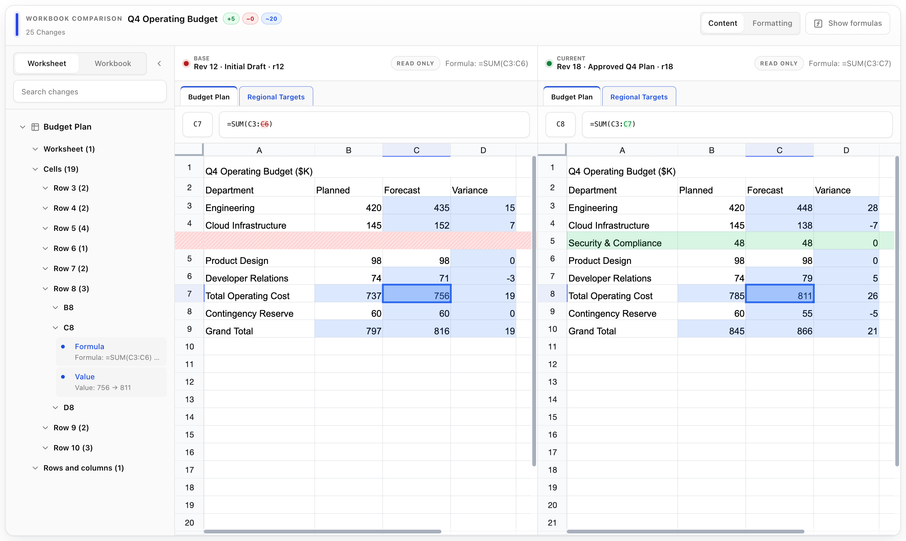

# Diff Viewer

[English](./README.md) | 简体中文

`@univerkit/diff-viewer` 是一个 React 组件包，用于以只读双栏形式展示 Univer Sheet、Doc、Slide、Base 和 Board Unit 的版本差异，并高亮结构化变更。

该包只消费比对结果和已解码的左右两侧 `unitData` 快照，不负责拉取比对会话、解码传输层载荷、管理路由或拼装 Univer 运行时；这些职责由宿主应用通过工厂函数注入。



## 职责与边界

| 层级                     | 职责                                                                                                                    |
| ------------------------ | ----------------------------------------------------------------------------------------------------------------------- |
| 宿主应用                 | 拉取比对结果、解码左右快照、配置 Univer preset/插件、管理鉴权与许可，以及按需提供左侧标题区控件。                       |
| `@univerkit/diff-viewer` | 双栏布局、可折叠差异侧边栏、Sheet/Slide/Base 范围切换、双栏联动滚动与选区同步、原生高亮叠加、公式差异栏以及内置多语言。 |
| Univer SDK / Pro SDK     | 以 peer 依赖提供的只读 Unit 渲染、Facade API 与 History 多语言词典。                                                    |

## 快速开始

在 Tailwind CSS v4 之后引入包样式表，使 Tailwind 扫描编译产物并生成组件所需的工具类：

```css
@import "tailwindcss";
@import "@univerkit/diff-viewer/styles.css";
```

传入比对载荷与宿主提供的 `createUniver` 工厂函数即可渲染：

```tsx
import { LocaleType } from "@univerjs/core";
import {
  UnitComparisonViewer,
  type UnitComparisonUniverFactory,
  type UnitComparisonViewerValue,
} from "@univerkit/diff-viewer";

const createComparisonUniver: UnitComparisonUniverFactory = async ({
  container,
  unitType,
  locale,
  darkMode,
}) => {
  // 将 createReadonlyUniver 替换为宿主应用中按 unitType 注册只读渲染插件的初始化逻辑
  const univer = createReadonlyUniver({ container, unitType, locale, darkMode });
  return {
    univer,
    dispose: () => univer.dispose(),
  };
};

export function ReviewComparison({
  comparison,
  darkMode,
}: {
  comparison: UnitComparisonViewerValue;
  darkMode: boolean;
}) {
  return (
    <div className="flex h-screen min-h-0 flex-col">
      <UnitComparisonViewer
        key={`${comparison.result.comparisonId}:${comparison.result.unit.unitId}`}
        comparison={comparison}
        createUniver={createComparisonUniver}
        locale={LocaleType.ZH_CN}
        darkMode={darkMode}
      />
    </div>
  );
}
```

当放置在有明确高度约束的 flex 或 grid 容器中时，组件会在左侧渲染可折叠的变更列表，在右侧渲染联动滚动的只读双栏视图。

## 安装

从 Univer insider registry 安装本包及其 peer 依赖：

```sh
pnpm add @univerkit/diff-viewer@rc --registry=https://insider-npm-registry.univer.work/
```

### Peer 依赖与运行环境

- **运行环境**：浏览器环境，需要 React `>=18 <20`、React DOM `>=18 <20` 和 Tailwind CSS `>=4`。
- **Univer SDK（`^1.6.0`）**：
  - 核心与渲染：`@univerjs/core`、`@univerjs/ui`、`@univerjs/drawing`、`@univerjs/engine-formula`、`@univerjs/engine-render`、`@univerjs/docs-ui`
  - 表格：`@univerjs/sheets`、`@univerjs/sheets-ui`、`@univerjs/sheets-conditional-formatting`、`@univerjs/sheets-filter`、`@univerjs/sheets-formula`、`@univerjs/sheets-numfmt`、`@univerjs/sheets-table`
  - Univer Pro：`@univerjs-pro/bases`、`@univerjs-pro/boards`、`@univerjs-pro/boards-ui`、`@univerjs-pro/edit-history-ui`、`@univerjs-pro/slides`、`@univerjs-pro/slides-ui`

请确保应用 lockfile 中所有 `@univerjs/*` 与 `@univerjs-pro/*` 保持同一兼容版本，避免出现多份 Univer DI 图或类型身份冲突。

## 使用说明

### 生命周期 `key`

请使用比对会话 ID 与 Unit ID 组合作为 React `key`（例如 `${comparison.result.comparisonId}:${comparison.result.unit.unitId}`）。仅在整个比对会话或目标 Unit 变化时更新 `key`；工作表切换、幻灯片切页以及选中变更项都会在已挂载的视图内部增量更新。

### 实现 `createUniver`

宿主工厂 `createUniver` 用于适配不同应用的 preset 与插件组合：

- 按传入的 `options.unitType`（`UNIVER_SHEET`、`UNIVER_DOC`、`UNIVER_SLIDE`、`UNIVER_BASE`、`UNIVER_BOARD`）注册对应渲染插件。
- 将实例挂载到 `options.container`，应用 `options.locale` 和 `options.darkMode`，并保持运行时为只读状态。
- 视图会为每一侧非空快照调用一次 `createUniver`（若某侧 `unitData` 为 `null` 则不创建），并在卸载、主题/语言重建或 Slide 切页时自动调用 `dispose()`。

### 样式与暗色模式

`@univerkit/diff-viewer/styles.css` 包含 `@source "./dist";`、默认 Tailwind v4 `@theme` 语义变量、`[data-unit-comparison-viewer="true"][data-dark-mode="true"]` 下的暗色变量覆盖，以及原生渲染容器的精简样式规则。

- 请在 Tailwind CSS（`@import "tailwindcss";` 或 `@import "tailwindcss/utilities.css";`）之后导入 `@univerkit/diff-viewer/styles.css`。
- 可在宿主样式表中覆盖语义色变量（如 `--color-background`、`--color-card`、`--color-border`、`--color-diff-insert`、`--color-diff-delete`、`--color-diff-update` 等）。
- 通过 `darkMode` prop 切换暗色模式；组件会在根节点写入 `data-dark-mode` 并将该值透传给 `createUniver`。
- 请确保父容器具备明确高度（如 `h-full` 或 `flex-1 min-h-0`），以便侧栏与双栏独立滚动。

### 多语言与文案覆盖

本包内置了 17 种 Univer 语言包（`ca-ES`、`de-DE`、`en-US`、`es-ES`、`fr-FR`、`id-ID`、`it-IT`、`ja-JP`、`ko-KR`、`pl-PL`、`pt-BR`、`ru-RU`、`sk-SK`、`vi-VN`、`zh-CN`、`zh-HK`、`zh-TW`），遇到未支持的 `LocaleType` 时自动回退到 `en-US`。

实体名称、属性路径与枚举值来自对应的 `@univerjs-pro/edit-history-ui` 语言包，用户文档内容不会被翻译。仅在需要自定义部分界面文案时传入可选的 `messages` prop：

```tsx
<UnitComparisonViewer
  comparison={comparison}
  createUniver={createComparisonUniver}
  locale={LocaleType.ZH_CN}
  darkMode={false}
  messages={{
    changes: "改动",
    side: { left: "基线版本", right: "提议版本" },
  }}
/>
```

### 自定义左侧标题区控件

传入 `leftHeaderControl` 可替换左栏默认标题区域，用于放置版本或比对来源选择器等宿主控件。

## API 参考

### `UnitComparisonViewer`

```ts
export function UnitComparisonViewer(props: IUnitComparisonViewerProps): ReactElement;
```

根据 `props.comparison.result.unit.type` 渲染对应类型的比对视图：

- **Sheet（`UNIVER_SHEET`）**：左右双栏只读表格，支持行列对齐空隙、工作表/工作簿树形侧栏、搜索过滤、内容/格式展示模式切换、公式文本显示与公式差异栏。
- **Doc、Slide、Board（`UNIVER_DOC`、`UNIVER_SLIDE`、`UNIVER_BOARD`）**：原生只读 Univer 双栏视图，支持段落/元素装饰、差异高亮叠加、幻灯片切页标签与视口联动。
- **Base（`UNIVER_BASE`）**：原始数据表差异网格，支持横纵联动滚动、数据表切换标签以及字段/记录/单元格级变更标记。

### `IUnitComparisonViewerProps`

| 属性                | 类型                                   | 必填 | 说明                                                                                                                                                             |
| ------------------- | -------------------------------------- | ---- | ---------------------------------------------------------------------------------------------------------------------------------------------------------------- |
| `comparison`        | `UnitComparisonViewerValue`            | 是   | 包含比对结果 `result` 及解码后 `left`/`right` 两侧数据的联合类型（`SheetComparisonViewerValue`、`BaseComparisonViewerValue` 或 `NativeComparisonViewerValue`）。 |
| `createUniver`      | `UnitComparisonUniverFactory`          | 是   | 为每一可见侧创建只读 Univer 实例的异步工厂函数。                                                                                                                 |
| `locale`            | `LocaleType`                           | 是   | 当前 Univer 语言，用于选择内置文案并透传给 `createUniver`。                                                                                                      |
| `darkMode`          | `boolean`                              | 是   | 控制组件暗色主题变量并透传给 `createUniver`。                                                                                                                    |
| `leftHeaderControl` | `ReactNode`                            | 否   | 渲染在左栏顶部的可选宿主控件，传入后替换默认侧栏标签。                                                                                                           |
| `messages`          | `UnitComparisonViewerMessageOverrides` | 否   | 叠加在内置语言包之上的深度可选文案覆盖。                                                                                                                         |

### `UnitComparisonUniverFactory`

```ts
export interface IUnitComparisonUniverFactoryOptions {
  readonly container: HTMLElement;
  readonly unitType: UnitComparisonType;
  readonly locale: LocaleType;
  readonly darkMode: boolean;
}

export interface IUnitComparisonUniverInstance {
  readonly univer: Univer;
  dispose(): void;
}

export type UnitComparisonUniverFactory = (
  options: IUnitComparisonUniverFactoryOptions,
) => Promise<IUnitComparisonUniverInstance>;
```

### 文案辅助导出

- `defaultUnitComparisonViewerMessages`：内置英文（`en-US`）的 `IUnitComparisonViewerMessages` 对象。
- `resolveUnitComparisonViewerMessages(locale?: LocaleType, overrides?: UnitComparisonViewerMessageOverrides): IUnitComparisonViewerMessages`：按 `locale` 解析内置语言包（默认回退至 `en-US`），并深度合并可选 `overrides`。

### 导出类型

- `IUnitComparisonResult`：结构化比对结果载荷（`schemaVersion: 1`、`comparisonId`、`unit`、`fidelity`、`summary`、`coverage`、`scopes`、`page`、`items`、`diagnostics`、`productContext`）。
- `IUnitComparisonViewerProps`：`UnitComparisonViewer` 的 props 类型。
- `IUnitComparisonViewerSide<TData>`：单侧比对数据（`label`、可选 `revision` 以及解码后的 `unitData: TData | null`）。
- `UnitComparisonViewerValue`：Sheet、Base 与原生（Doc、Slide、Board）比对载荷联合类型。
- `UnitComparisonUniverFactory`、`IUnitComparisonUniverFactoryOptions`、`IUnitComparisonUniverInstance`：Univer 运行时工厂契约类型。
- `IUnitComparisonViewerMessages`、`UnitComparisonViewerMessageOverrides`：完整及深度可选的文案覆盖类型。

## 限制与排查

- **两侧快照均为空（`unitData: null`）**：对于 Sheet 比对，如果 `left.unitData` 和 `right.unitData` 均为 `null`，组件会直接显示内联的无效载荷提示，不调用 `createUniver`。单侧缺失时，缺失侧会显示占位提示且不创建 Univer 实例。
- **样式丢失或工具类未生效**：确认 `@import "@univerkit/diff-viewer/styles.css";` 经过了 Tailwind CSS v4 处理管线，使 `@source "./dist";` 得以扫描产物目录。
- **高度塌陷或滚动异常**：组件根节点使用 `h-full min-h-0 flex-1`，请确保祖先容器具有明确高度约束（如 `h-screen`、`h-[600px]` 或带 `min-h-0` 的 flex/grid 链）。
- **多份 Univer 实例或 DI 报错**：检查 lockfile 是否只解析了一份 `@univerjs/core` 及同版本 `@univerjs/*` / `@univerjs-pro/*`，并确保 `createUniver` 每次调用都返回全新的 Univer 实例，不要在左右两栏之间复用同一实例。
- **Sheet 视图按需加载**：表格比对视图通过动态 `import()` 懒加载，非 Sheet 场景不会提前执行 Sheet Facade 注册逻辑。

## 本地验证

供仓库维护者在本地检出目录执行：

```sh
pnpm --filter @univerkit/diff-viewer build
pnpm --filter @univerkit/diff-viewer typecheck
pnpm --filter @univerkit/diff-viewer test
```

## 分发内容

npm 包包含 ES 模块产物（`dist/index.js` 及 `dist/chunks/` 下的懒加载分块）、TypeScript 类型声明（`dist/index.d.ts`）与 `styles.css`，不包含源码与 source map。

## 许可证

以 Apache-2.0 许可发布。本包依赖 Univer Pro（`@univerjs-pro/*`），使用时需遵循 [Univer 许可规则](https://docs.univer.ai/zh-CN/server/license)。第三方依赖保留其各自许可证。
