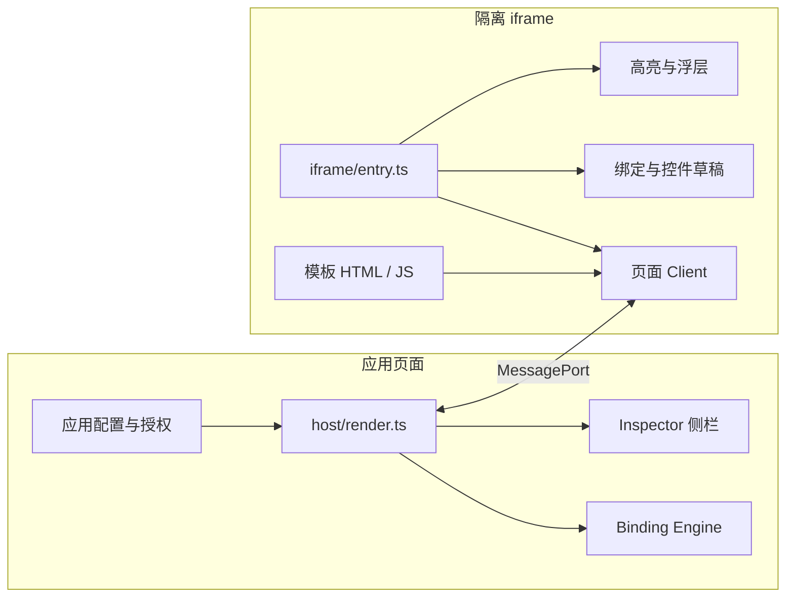
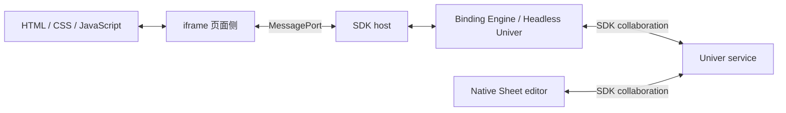
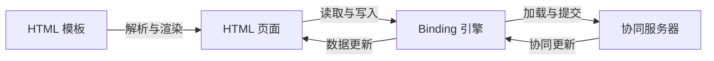
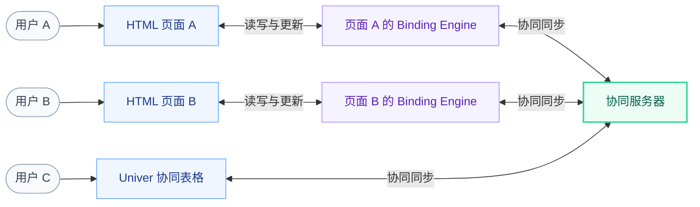
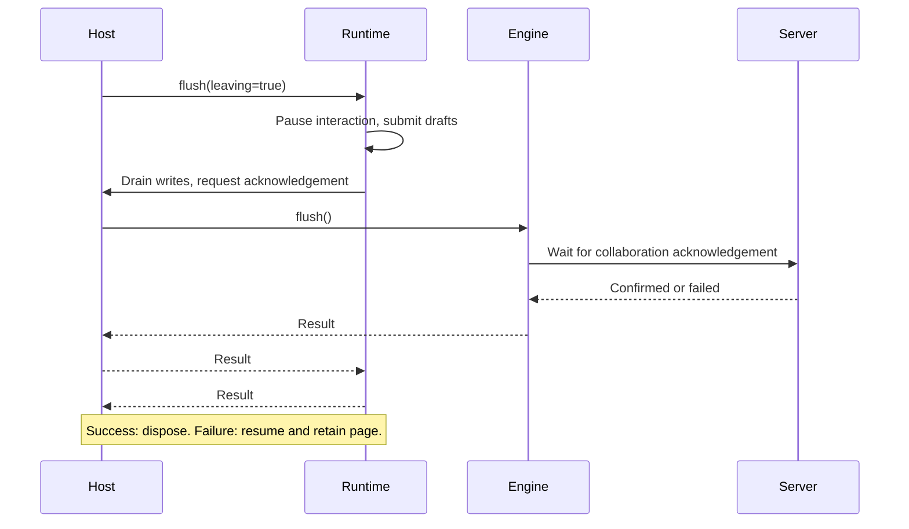

# HTML View 架构

[English](architecture.md)

[返回 README](../README.zh-CN.md) · [完整集成](integration.zh-CN.md) · [页面接口](javascript-api.zh-CN.md)。本文说明职责和数据流，可执行应用文件位于集成指南。

## 目标

HTML Views 允许作者自行选择 HTML 结构、CSS 样式和 JavaScript 行为，同时使用 Univer 协同数据。声明式属性覆盖单元格文本、控件及单元格与范围订阅，JavaScript 客户端支持单元格、范围、插行和自定义交互。两条路径共享引用、标量值、授权和保存生命周期。工作簿公式仍由 Univer 计算，结果通过订阅返回。

## 两个执行环境：host 与 iframe

`runtime` 只说明“执行中的代码”，无法说明代码在哪个页面执行。内部模块按实际执行环境命名：

| 边界                 | 执行位置           | 拥有的能力                                                         | 不承担的职责                                     |
| -------------------- | ------------------ | ------------------------------------------------------------------ | ------------------------------------------------ |
| **host：宿主侧**     | 应用页面           | 容器、iframe、握手、Engine 生命周期、保存状态、Inspector 侧栏      | 不直接访问隔离页面的 DOM                         |
| **iframe：页面侧**   | sandbox iframe 内  | 页面 API、绑定扫描、草稿、输入事件、拾取、高亮、tooltip 和详情浮层 | 不创建 Engine，不持有宿主凭据                    |
| **shared：公共定义** | 两侧各自编译和使用 | Client 接口类型、绑定检查数据与纯函数、MessagePort RPC             | 不访问 DOM，不装配任何一侧，不创建跨窗口共享实例 |

应用仍负责通过 `loadEngine` 提供已授权的数据连接，以及通过 `loadMetadata` 提供业务名称。应用与 SDK host 是不同职责：默认接入中，SDK host 完成 iframe 和通信的组装。



### 源码目录就是边界

```text
src/
├─ host/
│  ├─ render.ts               renderHtmlView 的宿主装配
│  ├─ binding-host.ts         请求校验、Engine 加载与保存
│  ├─ document.ts             生成 srcdoc 文档
│  ├─ inspector-panel.ts      宿主侧栏与名称加载
│  └─ view-style.ts           宿主布局样式
├─ iframe/
│  ├─ entry.ts                iframe 启动入口：API、握手、绑定装配
│  ├─ client.ts               页面 Client 与内部检查命令
│  ├─ dom.ts                  文本和控件绑定
│  ├─ element-subscriptions.ts 按 HTML ID 订阅
│  ├─ inspector.ts            页面拾取与高亮
│  └─ inspector-popover.ts    页面 tooltip 和详情浮层
├─ shared/
│  ├─ client-types.ts         页面 API 和内部数据接口类型
│  ├─ inspection.ts           检查数据结构、声明解析与地址格式化
│  ├─ inspection-presentation.ts 共用展示标签与名称回退
│  ├─ locale.ts               中英文界面文案
│  └─ rpc.ts                  不依赖具体页面的消息通信
├─ render.ts                 公开 /render 的薄导出入口
├─ dom.ts                    公开 /dom 的薄导出入口
└─ index.ts                  既有低层导出
```

内部文件只依赖同侧文件和 `shared`，`shared` 不反向依赖任何一侧。页面侧和 shared 对 Binding Engine 的引用只用于类型，不将 Engine 实现打进 iframe。`test/architecture.test.ts` 检查这些约束。

两侧通过 MessagePort 交换数据和命令，不跨目录直接调用对方的实现。唯一的构建资源依赖是 host 以**文本**携带 iframe 程序；这不会在宿主执行页面代码。

### 两个构建目标，一个 SDK 包

采用 B 方案：

```text
src/iframe/entry.ts + iframe/shared 依赖
    → 构建自包含 IIFE 脚本
.generated/iframe.js
    → host/render.ts 通过 ?raw 读取文本
公开 /render 的 ESM / CJS SDK 产物
```

包内 `scripts/build.mjs` 按序调用 `buildIframeProgram()` 和通用的 `buildPackage()`。第一步包含页面需要的依赖，第二步照常构建公开入口和声明文件。中间文件不提交、不发布；`pnpm build` 自动执行两步，`pnpm test` 自动准备页面程序。

iframe 程序是内部构建目标，启动入口为 `iframe/entry.ts`。应用使用 `/render`，不提供 `/runtime`、`/vite` 或旧入口兼容层。

## 页面与数据

页面有两种使用数据的方式：

- **HTML 绑定属性**：声明元素与单元格或范围的关系，由运行时自动同步文本和控件；自定义单元格或范围渲染通过 HTML ID 注册回调。
- **JavaScript 接口**：需要自定义数据处理或交互时，通过 `BindingEngineClient` 读取单元格、订阅变化、提交写入。

页面内容和交互由作者决定。HTML Views 提供数据连接与运行环境，不定义具体页面类型。

## 模块职责

| 组件                        | 职责                                                                   |
| --------------------------- | ---------------------------------------------------------------------- |
| 作者页面                    | 自有 DOM、样式、脚本、声明式绑定与自定义交互。                         |
| `@univerkit/html-view`      | 规范化 HTML 并解析声明，不执行脚本或加载数据。                         |
| SDK iframe 页面侧           | 绑定 DOM、保留草稿、提供异步客户端、管理页面检查与消息订阅。           |
| SDK host 宿主侧             | 创建隔离、校验握手与请求、管理 Engine 和检查侧栏、离开前保存。         |
| 接入应用                    | 提供模板、容器、授权后的 Engine 加载与业务名称查询。                   |
| `@univerkit/binding-engine` | 持有 Headless Univer 实例和一个 Sheet Unit，负责读写、订阅及协同组织。 |
| Univer 服务                 | 执行服务端权限、同步各客户端并持久化变更。                             |



一个页面可访问多个已授权 Unit，由宿主按 Unit 持有一个缓存 Engine。同一 Unit 的并发加载共享 Promise。另一个 HTML 页面或原生 Sheet 编辑器使用自己的客户端连接，变更通过协同服务同步，包括公式结果。所提供的浏览器实现中，图示宿主与 Engine 在本地调用。Node.js 部署需要应用提供远程传输与服务端 SDK 配置。

## 顶层概览

HTML 模板描述视图，解析与渲染层把它变成可交互的 HTML 页面，并通过 Binding 引擎
连接真实的 Unit 数据。页面中的展示随数据变化更新，用户编辑沿同一条绑定关系写回。



图中页面与 Binding 的连线表示数据关系，页面通过运行时与宿主通信完成读写和订阅。
页面通过 Binding 读取、订阅和写入数据；Binding 通过 Univer SDK 与协同服务器同步。

### 三个用户联动



两个用户使用 HTML 页面，另一个用户直接使用 Univer 协同表格，三者访问同一个 Unit。
任一端修改数据，其他端都能接收协同更新；表格中的公式结果也能反映到 HTML 页面。
每个页面持有自己的 Binding Engine，并通过服务端同步；具体部署见下文流程和集成指南。

## 加载与通信

1. 解析模板，以新 token 和 `sandbox="allow-scripts allow-forms"` 创建 iframe。
2. 在作者脚本前注入运行时，建立页面接口、挂载绑定并向父页面发送 port。
3. 校验 source、不透明 origin、消息类型、token 和 port 后创建宿主。
4. 校验每次请求，并在加载 Engine 前授权其 Unit；声明不等于访问白名单。
5. 读取返回状态，订阅先发送当前快照再发送变化，数据到达前控件保持禁用。
6. 写入按请求顺序执行，本地变化、远端变化和公式结果通过订阅返回。

请求和订阅使用独立标识来路由响应与通知，这些标识不代表用户、角色或授权。页面不能发送任意 SDK command、替换协同配置或访问内部对象。失败加载会从宿主缓存移除，调用方可显式重试，但运行时错误不会触发自动恢复或重放。通道关闭时拒绝待处理请求并停止通知。

## 编辑、保存与释放

运行时观察新增、移除和变更的绑定元素，共享匹配的订阅。订阅导致的 DOM 更新不触发写回。输入草稿不会被远端更新或在途写入响应覆盖，校验或写入错误保留草稿，Escape 恢复最新已知值。草稿和在途写入与 SDK 协同状态分别跟踪。



高层 view 的 `flush()` 和页面 `client.flush()` 都是保存并继续编辑。`view.prepareToLeave()` 暂停页面并保存，成功后保持暂停，再导航或释放；取消导航时调用 `view.resume()`。低层 Host 同样使用 `flush()` 保存并继续、`prepareToLeave()` 保存并暂停。失败时恢复交互以供修正或重试。释放不代表保存，且幂等：移除监听、计时器和订阅，关闭通道，取消待完成加载，释放 Engine 或迟到结果。浏览器关闭/刷新提示应结合运行时待保存变更与 SDK 未同步状态，强制结束无法保证持久化。

## 隔离边界

以下四项约束共同限定页面能力：

- **运行隔离**：页面不能访问宿主 DOM、凭据和内部实例。
- **数据授权**：通过宿主接口访问已授权 Unit，服务端校验读写权限。
- **输入校验**：校验引用、坐标和写入值，非法请求直接报错。
- **网络访问**：默认禁止外部请求，由宿主显式配置允许来源。

不透明 origin 的 sandbox 阻止访问宿主 DOM、凭据和 Univer 实例。CSP 限制外部资源/请求来源，同时允许作者内联代码和部分 data/blob 资源。`allowedOrigins` 不授予 Unit 权限。iframe 仍可导航自身，因此浏览器实现不保证完全断网。即使 HTML 语法合法，仍需宿主与服务端授权。UI Facade 扩展与 Headless Univer 不应共用 JavaScript 环境。

## 专题

| 文档                                               | 定义内容                                    |
| -------------------------------------------------- | ------------------------------------------- |
| [Renderer 入口](../README.zh-CN.md)                | 安装、接入职责、模板与公开导出。            |
| [View API](render.zh-CN.md)                        | 参数、状态、检查、保存与释放。              |
| [完整集成示例](integration.zh-CN.md)               | 可直接创建应用文件的 Vite 示例。            |
| [页面 JavaScript 接口](javascript-api.zh-CN.md)    | 引用与值、范围订阅、插行及保存。            |
| `@univerkit/html-view` 包内 `README.zh-CN.md`      | HTML 绑定属性与解析接口。                   |
| `@univerkit/binding-engine` 包内 `README.zh-CN.md` | Engine 工厂、部署、SDK 边界与协同生命周期。 |
