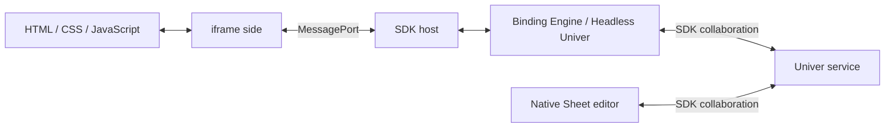
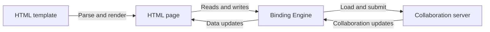
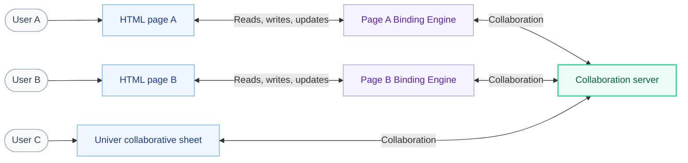
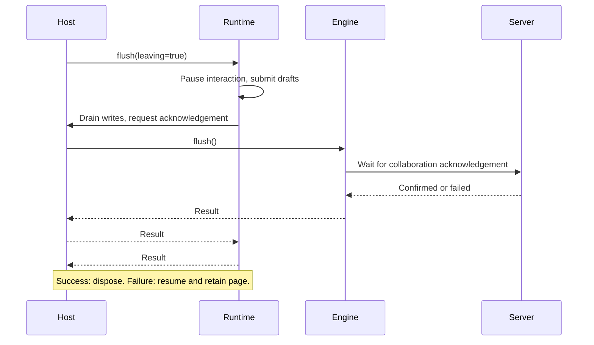

# HTML View architecture

[简体中文](architecture.zh-CN.md)

[Back to README](../README.md) · [Complete integration](integration.md) · [Page API](javascript-api.md). This guide describes responsibilities and data flow; the integration guide contains the executable application files.

## Purpose

HTML Views let authors choose HTML structure, CSS styling, and JavaScript behavior while using collaborative Univer data. Declarative attributes cover cell text, controls, and cell/range subscriptions; the JavaScript client supports cells, ranges, row insertion, and custom interactions. Both paths share references, scalar values, authorization, and the save lifecycle. Workbook formulas remain in Univer and their results flow back through subscriptions.

## Execution boundaries: host and iframe

The internal names identify where code executes. “Runtime” alone does not distinguish the application window from the isolated page.

| Boundary   | Executes in                           | Owns                                                                                          |
| ---------- | ------------------------------------- | --------------------------------------------------------------------------------------------- |
| **host**   | Application window                    | Container, iframe, handshake, engine lifecycle, save state, inspector sidebar                 |
| **iframe** | Sandboxed page                        | Page API, DOM bindings, drafts, input events, picking, highlights, tooltip and detail popover |
| **shared** | Compiled independently into each side | Client types, inspection data and pure helpers, MessagePort RPC                               |

The SDK host does not access the sandbox DOM directly. The iframe does not construct engines or hold host credentials. The application supplies authorization and connection configuration through `loadEngine`, and business names through `loadMetadata`.

```text
src/
  host/
    render.ts                 Host assembly and view lifecycle
    binding-host.ts           Request validation and engine ownership
    document.ts               srcdoc generation
    inspector-panel.ts        Host sidebar and metadata loading
    view-style.ts             Host layout
  iframe/
    entry.ts                  Page startup, API, handshake and binding assembly
    client.ts                 Page client and inspection commands
    dom.ts                    Text and model bindings
    element-subscriptions.ts  ById subscriptions
    inspector.ts              Picking and highlighting
    inspector-popover.ts      Tooltip and detail popover
  shared/
    client-types.ts           Public page API and internal data interfaces
    inspection.ts             Inspection records and pure declaration helpers
    inspection-presentation.ts Shared display labels and name fallbacks
    locale.ts                 English/Chinese interface messages
    rpc.ts                    MessagePort transport
  render.ts                   Thin public /render export
  dom.ts                      Thin public /dom export
  index.ts                    Existing low-level exports
```

Each side imports its own modules and shared modules. Shared modules have no DOM ownership or dependency on either implementation. Engine imports on the iframe side and in shared modules are type-only. `test/architecture.test.ts` checks these dependencies.

The two sides communicate through MessagePort. Shared code is compiled into each environment; it does not create shared object instances across windows. The host's import of the built iframe program is a text resource, not an executable import of iframe source.

### Two build targets in one package

```text
src/iframe/entry.ts and its dependencies
  → self-contained IIFE
.generated/iframe.js
  → imported as text with ?raw by host/render.ts
/render ESM and CJS artifacts
```

The package's `scripts/build.mjs` runs `buildIframeProgram()` before the generic `buildPackage()`. The intermediate file is neither committed nor published. The normal build command performs both steps; the package test command prepares the iframe program automatically. Consumers need no runtime URL, copied assets or SDK-specific plugin.

The iframe program is an internal build target. Applications use `/render`; there is no public `/runtime` or `/vite` entry.

## Pages and data

Pages access data in two ways:

- **HTML binding attributes** declare the relationship between an element and a cell or range. The runtime synchronizes text and controls automatically; custom cell/range rendering uses callbacks registered by HTML ID.
- **JavaScript APIs** let custom interactions read cells, subscribe to changes, and submit writes through `BindingEngineClient`.

Authors choose page content and interactions. HTML Views provides data connections and a runtime without prescribing a particular page type.

## Module responsibilities

| Component                     | Responsibility                                                                                          |
| ----------------------------- | ------------------------------------------------------------------------------------------------------- |
| Author page                   | Own DOM, styles, scripts, declarative bindings, and custom interactions.                                |
| `@univerkit/html-view-parser` | Normalize HTML and parse declarations; no script execution or data loading.                             |
| SDK iframe side               | Bind DOM, preserve drafts, expose the async client, and manage page inspection and subscriptions.       |
| SDK host side                 | Create isolation, validate requests, own engines and the inspector sidebar, coordinate saving.          |
| Application                   | Supply the template, container, authorized engine loader and business metadata.                         |
| `@univerkit/binding-engine`   | Own a Headless Univer instance and one Sheet Unit; read/write, subscribe, and coordinate collaboration. |
| Univer service                | Enforce server permissions, synchronize clients, and persist changes.                                   |



One page can access multiple authorized Units, with one cached engine per Unit owned by its host. Concurrent loads for the same Unit share a promise. Another HTML page or native Sheet editor uses its own client connection; updates converge through the collaboration service, including formula results. The diagram’s host-to-engine link is local in the supplied browser implementation. A Node.js deployment requires an application-provided remote transport and server-side SDK configuration.

## Top-level overview

An HTML template describes the view. The parsing and rendering layers turn it into an interactive page connected to real Unit data through Binding Engine. Data changes update the page, and user edits write back along the same binding relationships.



The page-to-Binding links represent data relationships. The page communicates through the runtime and host to read, subscribe, and write; Binding synchronizes with the collaboration server through the Univer SDK.

### Three collaborating users



Two users work with HTML pages while another uses the native collaborative sheet, all accessing the same Unit. An edit from any client can reach the others through collaboration, including formula results displayed in HTML pages. Each page owns its own Binding Engine and synchronizes through the server. Runtime and deployment details are covered in the flow below and the bundled integration guide.

## Load and communicate

1. Parse the template and create an iframe with a fresh token and `sandbox="allow-scripts allow-forms"`.
2. Inject the runtime before author scripts; it creates the page API, mounts bindings, and sends a port to the parent.
3. Verify source, opaque origin, message type, token, and port before creating the host.
4. Validate each request and authorize its Unit before loading an engine. Declarations are not an access list.
5. Reads return state; subscriptions send an immediate snapshot followed by changes. Controls remain disabled until data arrives.
6. Writes run in request order; local changes, remote changes, and formula results return through subscriptions.

Requests and subscriptions have independent identifiers for response/notification routing. These identifiers do not represent users, roles, or authorization. The page cannot issue arbitrary SDK commands, replace collaboration config, or access internal objects. Failed loads are removed from the host cache; callers may explicitly retry, but runtime errors do not trigger automatic recovery or replay. Channel closure rejects pending requests and stops notifications.

## Edit, save, and dispose

The runtime observes added, removed, and changed binding elements and shares matching subscriptions. DOM updates caused by subscriptions do not write back. Input drafts survive remote updates and in-flight write responses. Validation/write errors preserve the draft; Escape restores the latest known value. Drafts and in-flight writes are tracked separately from SDK collaboration status.



High-level `view.flush()` and page `client.flush()` both save and continue. `view.prepareToLeave()` pauses editing and saves, remaining paused on success; use `view.resume()` if navigation is cancelled. The low-level Host uses the same `flush()` and `prepareToLeave()` semantics. On failure interaction resumes for correction or retry. Disposal never implies saving and is idempotent. It removes listeners, timers, and subscriptions, closes the channel, aborts pending loads, and releases engines or late load results. Browser close/refresh warnings must combine runtime pending changes with unsynced SDK status; forced termination cannot guarantee persistence.

## Isolation boundaries

Four constraints define page capabilities:

- **Runtime isolation**: pages cannot access host DOM, credentials, or internal instances.
- **Data authorization**: host APIs expose authorized Units, and the server checks read/write permissions.
- **Input validation**: invalid references, coordinates, and write values fail explicitly.
- **Network access**: external requests are blocked by default, with allowed origins configured by the host.

The opaque-origin sandbox prevents access to host DOM, credentials, and Univer instances. CSP restricts external resource/request origins, with inline author code and selected data/blob resources allowed. `allowedOrigins` does not grant Unit permissions. Iframe self-navigation is still possible, so the browser implementation does not guarantee completely offline execution. Host and server authorization remain necessary even for syntactically valid HTML. UI Facade extensions and Headless Univer should not share a JavaScript environment.

## Topic guides

| Document                                       | Covers                                                                   |
| ---------------------------------------------- | ------------------------------------------------------------------------ |
| [Renderer entry](../README.md)                 | Installation, integration responsibilities, templates, and exports.      |
| [View API](render.md)                          | Inputs, state, inspection, saving, and disposal.                         |
| [Complete integration example](integration.md) | Vite application files that can be created directly.                     |
| [Page JavaScript API](javascript-api.md)       | References and values, range subscriptions, insertion, and saving.       |
| `README.md` in `@univerkit/html-view-parser`   | HTML binding attributes and parser APIs.                                 |
| `README.md` in `@univerkit/binding-engine`     | Engine factory, deployment, SDK boundaries, and collaboration lifecycle. |
