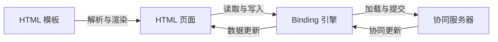
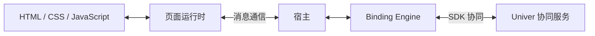
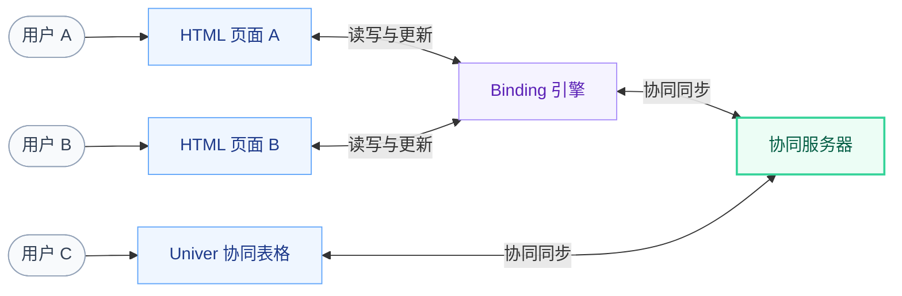

# HTML 数据绑定概览

本页介绍 HTML 数据绑定的整体设计，以及 `@univerkit/binding-engine`、`@univerkit/html-view-parser`、
`@univerkit/html-view` 三个包如何分工。在应用中渲染页面从
[`@univerkit/html-view`](../README.zh-CN.md) 开始。

页面可以通过 HTML 属性展示单元格、绑定表单控件，也可以通过 `window.univerBinding`
读取单元格或矩形范围、订阅变化、修改单元格，以及插入行并填值。每个 Binding Engine 拥有一个独立的 Headless Univer 实例和
一个 Sheet Unit，数据同步与公式计算由 Univer SDK 负责。

## 顶层概览

HTML 模板描述视图，解析与渲染层把它变成可交互的 HTML 页面，并通过 Binding 引擎
连接真实的 Unit 数据。页面中的展示随数据变化更新，用户编辑沿同一条绑定关系写回。



图中页面与 Binding 的连线表示数据关系，页面通过运行时与宿主通信完成读写和订阅。
页面通过 Binding 读取、订阅和写入数据；Binding 通过 Univer SDK 与协同服务器同步。

## 整体架构



一个页面可以访问多个已授权 Unit。宿主为该页面按 Unit 管理 Engine，每个 Engine 绑定
一个 Sheet Unit，并拥有一个独立的 Headless Univer 实例。页面获得数据接口，Engine 和凭据由宿主管理。

### 三个用户联动



两个用户使用 HTML 页面，另一个用户直接使用 Univer 协同表格，三者访问同一个 Unit。
任一端修改数据，其他端都能接收协同更新；表格中的公式结果也能反映到 HTML 页面。
图中的 Binding 引擎表示统一的数据绑定能力，具体运行与部署方案在专题中讨论。

## 包与文档

| 包                                                                      | 职责                                                | 文档                                                                         |
| ----------------------------------------------------------------------- | --------------------------------------------------- | ---------------------------------------------------------------------------- |
| [`@univerkit/binding-engine`](../../binding-engine/README.zh-CN.md)     | Unit 加载、单元格读写、插行填值、订阅与协同生命周期 | [变化监听与方案比较](../../binding-engine/docs/change-subscription.zh-CN.md) |
| [`@univerkit/html-view-parser`](../../html-view-parser/README.zh-CN.md) | HTML 绑定属性、引用解析与校验                       | [校验示例](../../html-view-parser/docs/validation.zh-CN.md)                  |
| [`@univerkit/html-view`](../README.zh-CN.md)                            | 隔离页面运行时、客户端接口与宿主消息桥接            | 见下方导航                                                                   |

三个包按同一版本一起发布。包通过公开 exports 提供 ESM 与 TypeScript 类型声明，不依赖具体应用、
应用登录状态或其他仓库的源码。

## 文档导航

| 目标                                               | 文档                                                                                 |
| -------------------------------------------------- | ------------------------------------------------------------------------------------ |
| 加载、读写和订阅工作簿                             | [Binding Engine](../../binding-engine/README.zh-CN.md)                               |
| 编写与校验 HTML 绑定声明                           | [HTML View](../../html-view-parser/README.zh-CN.md)                                  |
| 将模板渲染到应用容器                               | [Renderer](../README.zh-CN.md)、[完整集成](integration.zh-CN.md)                     |
| 查询 view 的参数、状态和生命周期                   | [renderHtmlView](render.zh-CN.md)                                                    |
| 使用内置检查面板、tooltip 与名称查询               | [绑定检查](binding-inspection.zh-CN.md)                                              |
| 编写模板 JavaScript                                | [页面 API](javascript-api.zh-CN.md)                                                  |
| 了解 host / iframe / shared 的职责、通信和生命周期 | [架构](architecture.zh-CN.md)                                                        |
| 了解 iframe 程序的构建方案与取舍                   | [iframe 程序构建决策](iframe-build.zh-CN.md)                                         |
| 运行完整示例                                       | [html-data-binding-basic](../../../examples/html-data-binding-basic/README.zh-CN.md) |

## 运行示例

示例包含文件列表、协同 Sheet 与 HTML 图表，使用 SQLite 持久化，没有登录、角色或应用权限系统。在仓库根目录运行：

```bash
pnpm install
pnpm build
pnpm --filter @univerkit/example-html-data-binding-basic start
```

打开 <http://127.0.0.1:3030/>。默认包含 **Team budget** 表格和 **Team budget.univer.html** 页面。
分别在两个标签页中打开它们，修改收入或支出，即可看到表格、公式结果和 HTML 柱状图同步更新。
更多功能和开发方式见[示例说明](../../../examples/html-data-binding-basic/README.zh-CN.md)。

浏览器集成测试覆盖双向协同、图表更新、文件切换、保存和页面隔离：

```bash
pnpm exec playwright install chromium
pnpm test:e2e
```

## 运行边界

HTML 在 sandbox iframe 中执行，通过宿主消息桥接访问数据，不具有宿主同源权限。
CSP 限制外部资源和请求的允许来源；iframe 仍可通过 `location.href` 导航自身，因此不保证完全断网。
Unit 授权和协同凭据由宿主负责，服务端负责实际访问校验。
